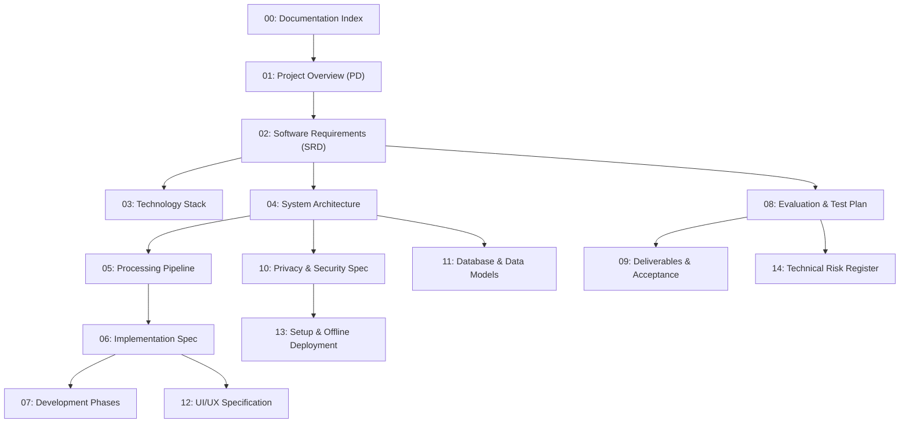

# 00 — Project Documentation Index: Tinyverse On-Device Scam Message Detector

- **Project Name:** Tinyverse — On-Device Scam Message Detector
- **Problem Statement:** Tinyverse PS 1 — On-Device Scam Message Detector
- **Project Version:** `1.1.0` (Milestone 7 Complete — Hackathon Ready)
- **Documentation Status:** Active, Finalized & Synchronized with Implementation
- **Architecture Paradigm:** 100% Local, Privacy-Preserving Hybrid NLP & Rule-Based Classifier

---

## 1. Project Description

The **Tinyverse On-Device Scam Message Detector** is a desktop-ready, fully offline machine learning application designed to protect Indian SMS and WhatsApp users from financial, identity, and social-engineering fraud without exposing private messages to external cloud servers.

Given a single copied SMS or WhatsApp message, the system performs all preprocessing, feature extraction, statistical machine learning classification, and rule-based indicator analysis locally in memory (`127.0.0.1`) and outputs:
1. **Verdict:** `SCAM` or `SAFE`
2. **Category:** `KYC/Bank`, `Lottery/Prize`, `Loan/Credit`, `Job/Investment`, or `Other` (when `SCAM`; `null`/`None` when `SAFE`)
3. **Confidence Score:** A percentage (`0%–100%`) derived from held-out validation probability calibration (or explicitly labeled as an experimental model confidence score where sample size is constrained)
4. **Human-Readable Explanation & Safety Warnings:** Specific indicators and feature signals that triggered the classification, accompanied by a non-alarmist verification reminder.

---

## 2. Master Documentation Index

This `docs/` directory serves as the authoritative technical specification and engineering reference for the project. All root-level markdown files (`README.md`, `IMPLEMENTATION.md`, `ARCHITECTURE.md`, `DATA_AND_MODEL.md`, `PRIVACY_AND_OFFLINE.md`, `TEST_PLAN.md`, `DEMO_SCRIPT.md`) summarize and link directly into this 15-document suite.

| Doc ID | Document Filename | Primary Purpose | Target Audience |
|---|---|---|---|
| **00** | [00_README_Project_Documentation_Index.md](file:///C:/Users/supri/Downloads/Tinyverse-Scam-Detector/Tinyverse_Scam_Detector_Starter_Pack/docs/00_README_Project_Documentation_Index.md) | Master index, document map, version metadata, and technology overview. | All readers, Hackathon Judges, Developers |
| **01** | [01_Project_Overview_PD.md](file:///C:/Users/supri/Downloads/Tinyverse-Scam-Detector/Tinyverse_Scam_Detector_Starter_Pack/docs/01_Project_Overview_PD.md) | Problem definition, Indian scam landscape, project scope, target personas, and value proposition. | Hackathon Judges, Product Evaluators |
| **02** | [02_SRD.md](file:///C:/Users/supri/Downloads/Tinyverse-Scam-Detector/Tinyverse_Scam_Detector_Starter_Pack/docs/02_SRD.md) | Formal Software Requirements Document (`FR-001`..`FR-015`, `NFR-001`..`NFR-010`), constraints, use cases, and traceability matrix. | Systems Engineers, QA, Judges |
| **03** | [03_Technology_Stack.md](file:///C:/Users/supri/Downloads/Tinyverse-Scam-Detector/Tinyverse_Scam_Detector_Starter_Pack/docs/03_Technology_Stack.md) | Detailed breakdown of verified installed libraries, rationale, alternatives rejected, and technical limitations. | ML Engineers, Python Developers |
| **04** | [04_System_Architecture.md](file:///C:/Users/supri/Downloads/Tinyverse-Scam-Detector/Tinyverse_Scam_Detector_Starter_Pack/docs/04_System_Architecture.md) | High-level, component, training, inference, and privacy-boundary architecture with Mermaid diagrams. | Software Architects, Security Auditors |
| **05** | [05_Processing_Pipeline.md](file:///C:/Users/supri/Downloads/Tinyverse-Scam-Detector/Tinyverse_Scam_Detector_Starter_Pack/docs/05_Processing_Pipeline.md) | End-to-end 13-stage message processing walkthrough covering English, Hinglish (`hi-Latn`), and leetspeak obfuscation. | NLP Specialists, ML Engineers |
| **06** | [06_Implementation_Specification.md](file:///C:/Users/supri/Downloads/Tinyverse-Scam-Detector/Tinyverse_Scam_Detector_Starter_Pack/docs/06_Implementation_Specification.md) | Exact module contracts, function signatures, dataclasses, error handling, and artifact persistence specifications. | Developers, Code Reviewers |
| **07** | [07_Development_Phases.md](file:///C:/Users/supri/Downloads/Tinyverse-Scam-Detector/Tinyverse_Scam_Detector_Starter_Pack/docs/07_Development_Phases.md) | 7-Milestone development plan, task breakdowns, completion gates, and live status tracking table. | Project Managers, Mentors |
| **08** | [08_Evaluation_and_Test_Plan.md](file:///C:/Users/supri/Downloads/Tinyverse-Scam-Detector/Tinyverse_Scam_Detector_Starter_Pack/docs/08_Evaluation_and_Test_Plan.md) | Dataset audit, train/val/test split strategy, leakage prevention, measured ML baseline metrics, and pytest matrix. | ML Evaluators, QA Testers |
| **09** | [09_Deliverables_and_Acceptance.md](file:///C:/Users/supri/Downloads/Tinyverse-Scam-Detector/Tinyverse_Scam_Detector_Starter_Pack/docs/09_Deliverables_and_Acceptance.md) | Checklist of code, model, documentation, test, and privacy deliverables alongside acceptance criteria. | Hackathon Judges, Team Leads |
| **10** | [10_Privacy_and_Security_Specification.md](file:///C:/Users/supri/Downloads/Tinyverse-Scam-Detector/Tinyverse_Scam_Detector_Starter_Pack/docs/10_Privacy_and_Security_Specification.md) | Threat model, zero-telemetry guarantees, localhost loopback binding, URL safety, and offline verification protocol. | Cybersecurity Engineers, Privacy Judges |
| **11** | [11_Database_and_Data_Models.md](file:///C:/Users/supri/Downloads/Tinyverse-Scam-Detector/Tinyverse_Scam_Detector_Starter_Pack/docs/11_Database_and_Data_Models.md) | Justification for stateless file-based storage (`CSV` + `Joblib`), dataset schema, and prediction input/output schemas. | Data Engineers, Backend Developers |
| **12** | [12_UI_UX_Specification.md](file:///C:/Users/supri/Downloads/Tinyverse-Scam-Detector/Tinyverse_Scam_Detector_Starter_Pack/docs/12_UI_UX_Specification.md) | Cybersecurity dashboard layout, wireframes, color semantics, confidence disclosures, and accessibility rules. | UI/UX Designers, Frontend Developers |
| **13** | [13_Setup_and_Deployment_Guide.md](file:///C:/Users/supri/Downloads/Tinyverse-Scam-Detector/Tinyverse_Scam_Detector_Starter_Pack/docs/13_Setup_and_Deployment_Guide.md) | Beginner-friendly step-by-step installation, training, testing, and air-gapped execution commands for Windows & POSIX. | Beginners, Judges, End Users |
| **14** | [14_Risk_Register.md](file:///C:/Users/supri/Downloads/Tinyverse-Scam-Detector/Tinyverse_Scam_Detector_Starter_Pack/docs/14_Risk_Register.md) | Formal 15-item technical risk register with likelihood, impact, severity scoring, mitigations, and verification checks. | Systems Engineers, Technical Judges |

---

## 3. How the Documents Relate to Each Other

1. **Problem & Requirements Layer (`01`, `02`, `09`):** Defines *why* the system exists, *what* functional and non-functional requirements (`FR`/`NFR`) it must satisfy, and how final acceptance is verified.
2. **Architecture & Data Layer (`03`, `04`, `05`, `11`):** Defines *how* data flows through the normalization, TF-IDF vectorization, ML classification, and rule engines without any external network dependency or persistent user database.
3. **Implementation & Interface Layer (`06`, `07`, `12`, `13`):** Specifies exact Python modules (`src/features.py`, `src/classifier.py`, `src/rules.py`, `src/privacy_audit.py`, `train.py`, `predict.py`, `app.py`), UI specifications, milestone gates, and terminal commands.
4. **Verification, Privacy & Risk Layer (`08`, `10`, `14`):** Provides empirical evaluation metrics, threat modeling, air-gapped verification procedures, and honest technical risk tracking.

---

## 4. Technology Overview

| Component | Selected Technology | Verified Environment Version | Role in System |
|---|---|---|---|
| **Language** | Python | `3.12.10` (`>=3.11` required) | Core runtime for data processing, training, inference, and UI. |
| **Frontend UI** | Streamlit | `1.67.0` (`>=1.36,<2`) | Local browser dashboard bound strictly to `127.0.0.1`. |
| **Machine Learning** | Scikit-learn | `1.9.1` (`>=1.4,<2`) | `TfidfVectorizer`, `FeatureUnion`, `LogisticRegression`, `CalibratedClassifierCV`, metrics. |
| **Data Manipulation** | Pandas | `3.1.1` (`>=2.2,<4`) | Dataset loading, schema validation, deduplication, and reporting. |
| **Model Persistence** | Joblib | `1.6.0` (`>=1.3,<2`) | Local serialization of trained pipelines and metadata to `models/`. |
| **Testing Framework** | Pytest | `8.4.2` (`>=8,<9`) | Automated unit, regression, false-positive, and privacy testing. |
| **Visualization** | Matplotlib | `3.11.2` (`>=3.8,<4`) | Local generation of evaluation charts and confusion matrices. |
| **Version Control** | Git | `2.51.0.windows.1` | Source control and artifact ignore rules (`.gitignore`). |
