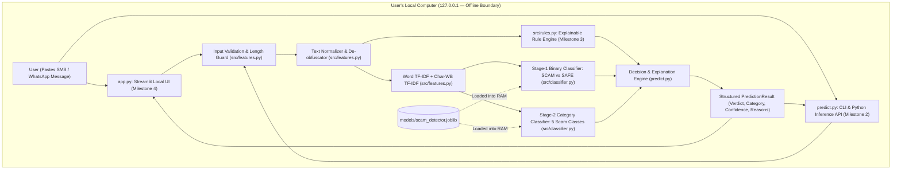
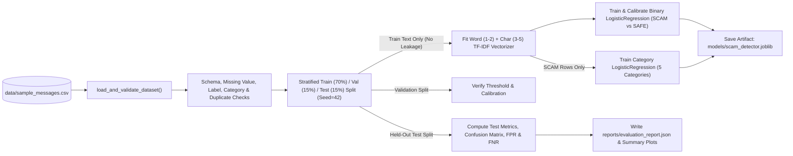
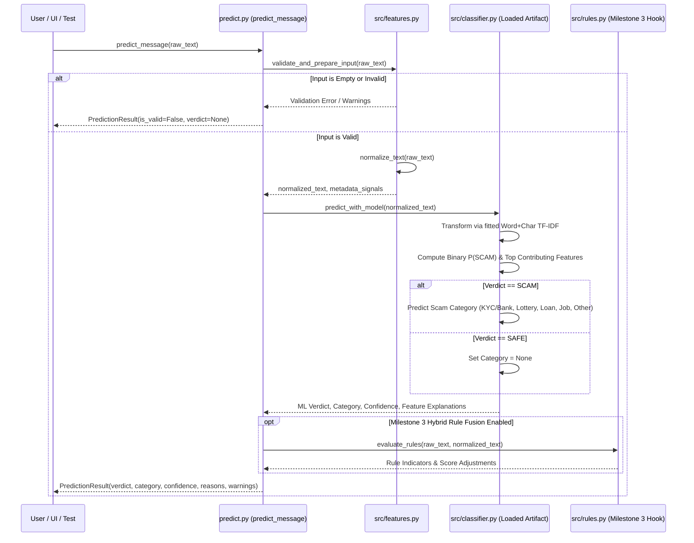
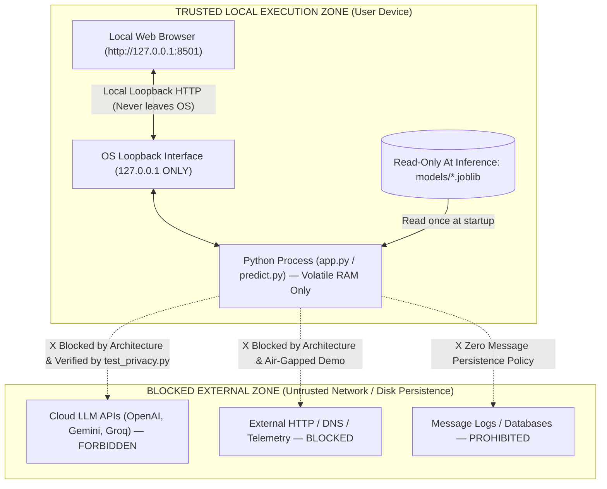

# 04 — System Architecture Specification

## 1. Architectural Vision & Design Principles

The Tinyverse Scam Detector follows a **Local-First, Modular, Dual-Stage Hybrid Architecture**:
1. **Strict Local Execution Boundary:** All components run inside a single user-owned operating system process. There are no external microservices, no cloud inference endpoints, and no remote databases.
2. **Separation of Concerns:** UI rendering (`app.py`), orchestration (`predict.py`, `train.py`), feature normalization (`src/features.py`), statistical ML (`src/classifier.py`), explainable domain rules (`src/rules.py`), and privacy auditing (`src/privacy_audit.py`) are isolated into independent modules with clean interfaces.
3. **Phased Hybrid Evolution:**
   - **Milestone 2 (Current Implementation):** Establishes the complete, leakage-free **Machine Learning Pipeline** (`src/features.py`, `src/classifier.py`, `train.py`, `predict.py`) so baseline ML accuracy and false-positive rates can be measured independently.
   - **Milestone 3 (Planned Next Step):** Integrates the **Explainable Rule Engine** (`src/rules.py`) with the ML probabilities via calibrated decision fusion.
   - **Milestone 4 (Planned UI):** Connects the **Streamlit Dashboard** (`app.py`) to `predict.py` and `reports/`.

---

## 2. Diagram 1: Overall System Architecture

---

## 3. Diagram 2: Reproducible Training Pipeline Architecture (`train.py`)

---

## 4. Diagram 3: Runtime Prediction Pipeline (`predict.py`)

---

## 5. Diagram 4: Privacy & Trust Boundary Architecture

---

## 6. Component & Module Responsibilities

| Module Path | Layer | Core Responsibilities | Status |
|---|---|---|---|
| `src/features.py` | Preprocessing & Feature Engineering | Input length/type validation, Unicode NFKC normalization, obfuscation/leetspeak normalization, structural metadata extraction, and Scikit-learn `FeatureUnion` TF-IDF builder. | **Implemented (Milestone 2)** |
| `src/classifier.py` | Machine Learning Core | Dataset schema validator, stratified train/val/test splitter, binary `SCAM`/`SAFE` classifier, 5-class scam category classifier, per-message feature attribution, and `joblib` persistence. | **Implemented (Milestone 2)** |
| `train.py` | Training & Reporting CLI | Orchestrates dataset validation, training, held-out evaluation, confusion matrix plotting, and saving `models/scam_detector.joblib` and `reports/*`. | **Implemented (Milestone 2)** |
| `predict.py` | Inference API & CLI | Loads local model artifact once (cached), runs end-to-end prediction on a single message, enforces output schema (`SAFE` -> `category=None`), and provides CLI testing. | **Implemented (Milestone 2)** |
| `src/rules.py` | Explainable Rule Engine | Modular pattern detectors for suspicious URLs, KYC/bank threats, OTP/PIN harvesting, advance fees, lottery claims, and safe-message dampeners. | **Planned (Milestone 3)** |
| `app.py` | Local User Interface | Streamlit dashboard bound to `127.0.0.1` with input box, Analyze/Clear buttons, color-coded result cards, and model/evaluation tabs. | **Planned (Milestone 4)** |
| `src/privacy_audit.py` | Security & Privacy Verification | AST-based static scanner for banned network libraries, dependency auditor, and runtime socket-blocking verification helpers. | **Planned (Milestone 6)** |

---

## 7. Key Architecture Decisions (ADRs)

- **ADR-01: Two-Stage Hierarchical Classification vs. Single 6-Class Classifier:**
  - *Decision:* Separate Binary Classification (`SCAM` vs `SAFE`) from Scam Category Classification (`5 categories`).
  - *Rationale:* Binary scam detection requires high recall and low false-positive rates across two broad classes, whereas category classification only applies to confirmed scams. Separating them guarantees that `SAFE` messages never receive a scam category and prevents the `SAFE` class (52 rows) from dominating smaller scam subcategories (12–28 rows).
- **ADR-02: Combined Word + Character-WB TF-IDF (`FeatureUnion`):**
  - *Decision:* Combine word n-grams (`1, 2`) with character word-boundary n-grams (`3, 5`).
  - *Rationale:* Word n-grams provide readable phrase explanations (`"share otp"`, `"processing fee"`), while character n-grams capture subword roots across Hinglish spelling variants and leetspeak obfuscations (`K.Y.C`, `fr33`, `l0an`).
- **ADR-03: Single Read-Only Canonical Dataset Source:**
  - *Decision:* Designate `data/sample_messages.csv` as the single authoritative canonical dataset and treat it strictly as read-only during `train.py`.
  - *Rationale:* Prevents unnecessary file writes into `data/` during training and avoids schema or content drift.
