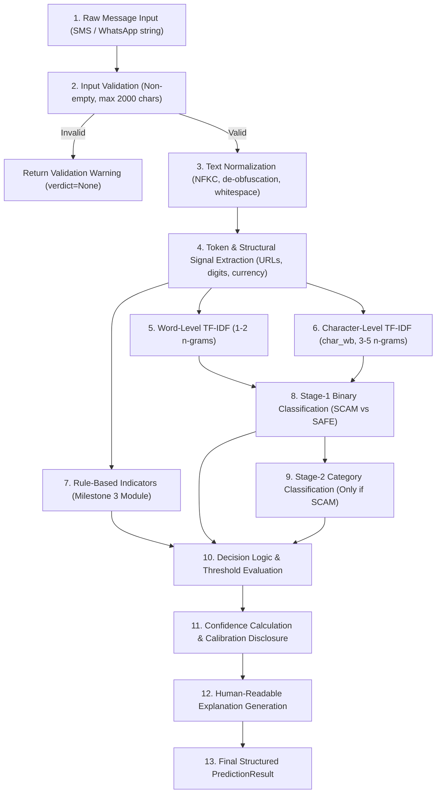

# 05 — Message Processing Pipeline Specification

## 1. End-to-End 13-Stage Processing Pipeline

Every message submitted to the Tinyverse Scam Detector passes through a deterministic 13-stage local pipeline:

---

## 2. Detailed Stage-by-Stage Specification

### Stage 1: Message Input
- Receives a single string copied by the user from an SMS inbox or WhatsApp chat.

### Stage 2: Input Validation (`validate_message_input`)
- **Type Check:** Ensures input is a Python `str`.
- **Empty/Whitespace Check:** Strips leading and trailing whitespace; if the resulting string is empty (`len == 0`), returns `is_valid=False` with reason `"Message input is empty. Please paste a valid SMS or WhatsApp message."`
- **Maximum Length Bound:** If `len(text) > 2000` (`MAX_MESSAGE_LENGTH`), truncates the string safely to `2,000` characters and appends a warning to `warnings`: `"Message exceeded 2000 characters and was safely truncated for local analysis."`

### Stage 3: Text Normalization (`normalize_text`)
To preserve useful fraud signals while defeating adversarial formatting, `src/features.py` performs dual normalization:
1. **Unicode Normalization (`NFKC`):** Converts full-width characters and compatibility glyphs into standard ASCII/Unicode equivalents and strips zero-width joiners (`\u200b`, `\u200c`, `\u200d`, `\ufeff`) often inserted by scammers to break keyword filters.
2. **Dotted Acronym Compaction:** Collapses punctuated acronyms like `K.Y.C`, `O.T.P`, `U.P.I`, and `P.I.N` into `kyc`, `otp`, `upi`, `pin` alongside the original token so both character and word vectorizers recognize them.
3. **Targeted Leetspeak De-obfuscation Token Append:** Identifies mixed alphanumeric/symbol obfuscations (`fr33`, `fr33e`, `pr1ze`, `l0an`, `appr0ved`, `acc0unt`, `bl0ck`, `cl1ck`, `h3re`, `upd@te`, `b@nk`, `c0ngratulati0ns`, `temp0rarily`) by generating a de-obfuscated companion view (`0->o`, `1->i/l`, `3->e`, `@->a`, `$->s`) when letters and leet digits are mixed inside a word, while preserving genuine numbers like `Rs 500`, `482913`, or `24 hours`.
4. **Case-Folding & Whitespace Collapse:** Lowercases text and collapses multiple spaces/newlines into single spaces.

### Stage 4: Token & Structural Signal Handling (`extract_text_signals`)
Before vectorization, structural patterns are replaced or tagged with canonical semantic tokens appended to the normalized text so the linear model can learn structural concepts across different numbers or domains:
- URL presence (`__has_url__`), shortened URL presence (`bit.ly`, `tinyurl.com`, `t.me` -> `__short_url__`), suspicious TLDs (`.xyz`, `.top`, `.club`, `.site`, `.online` -> `__suspicious_tld__`), IP-address URLs (`__ip_url__`), and APK file mentions (`__apk_file__`).
- Currency amounts (`Rs`, `INR`, `lakh`, `$` -> `__currency_amount__`).
- Protective negation phrases (`"do not share"`, `"never share"`, `"kisi ke saath share mat karna"`, `"kabhi otp nahi maangta"`, `"never charge any fee"` -> `__protective_warning__`).

### Stage 5: Word-Level TF-IDF (`word_tfidf`)
- **Configuration:** `TfidfVectorizer(analyzer="word", ngram_range=(1, 2), min_df=1, max_features=3000, sublinear_tf=True)`
- **Why Sublinear TF:** Applies $1 + \log(\text{tf})$ so a scammer repeating a safe word 10 times cannot linearly overwhelm the dot product.
- **Role:** Captures whole words and 2-word phrases such as `"share otp"`, `"processing fee"`, `"registration fee"`, `"lucky draw"`, `"out for delivery"`, and `"do not"`.

### Stage 6: Character-Level TF-IDF (`char_tfidf`)
- **Configuration:** `TfidfVectorizer(analyzer="char_wb", ngram_range=(3, 5), min_df=2, max_features=4000, sublinear_tf=True)`
- **Role:** Extracts 3-to-5 character substrings bounded by word spaces (`char_wb`). For example, `"bhejo"` and `"bhejein"` both generate `" bhe"`, `"bhej"`; `"l0an"` and `"loan"` share boundary character patterns and de-obfuscated companion tokens.

### Stage 7: Rule-Based Indicators (`src/rules.py` — Milestone 3 Integration)
- In Milestone 2, the pipeline runs in **Pure ML Baseline Mode** (`use_rules=False` or stubbed) so we can measure raw ML performance honestly.
- In Milestone 3, `src/rules.py` executes in parallel to extract explicit human-readable cybersecurity indicators (KYC suspension threats, upfront fee demands, suspicious links, and safe-message dampeners).

### Stage 8: Stage-1 Binary Classification (`SCAM` vs `SAFE`)
- The combined Word + Character TF-IDF vector $v(x)$ is passed into the trained binary classifier (`LogisticRegression(C=2.0, class_weight="balanced")` wrapped with probability calibration).
- Produces $P(\text{SCAM} \mid x) \in [0.0, 1.0]$.

### Stage 9: Stage-2 Category Classification
- **Strict Gate:** Executed **if and only if** the final binary verdict is `"SCAM"`.
- Passes $v(x)$ into the 5-class Multinomial Logistic Regression classifier trained exclusively on `SCAM` examples to predict:
  - `KYC/Bank`
  - `Lottery/Prize`
  - `Loan/Credit`
  - `Job/Investment`
  - `Other`
- If the binary verdict is `"SAFE"`, Stage 9 is bypassed and `category` is strictly set to `None`.

### Stage 10: Decision Logic & Thresholding
- Compares $P(\text{SCAM} \mid x)$ against the validated decision threshold $\tau$ (default $\tau = 0.50$, verified on the validation split to minimize false positives on `SAFE` messages while maintaining high scam recall).
- If $P(\text{SCAM} \mid x) \ge \tau \implies \text{verdict} = \text{"SCAM"}$, else $\text{"SAFE"}$.

### Stage 11: Confidence Calculation
- If `verdict == "SCAM"`, $\text{confidence} = \text{round}(P(\text{SCAM} \mid x) \times 100, 1)$.
- If `verdict == "SAFE"`, $\text{confidence} = \text{round}((1.0 - P(\text{SCAM} \mid x)) \times 100, 1)$.
- Includes metadata disclosure noting that confidence is calibrated on a small synthetic dataset and should be interpreted as a model confidence score rather than a real-world statistical guarantee.

### Stage 12: Explanation Generation (`explain_prediction`)
- Inspects the linear model weights ($w_i \times x_i$) for the active word features present in the message and translates top statistical contributors and structural tags (`__short_url__`, `__protective_warning__`, etc.) into clear, plain-English sentences.

### Stage 13: Final Result Packaging
- Returns a `PredictionResult` dataclass (and dictionary representation via `.to_dict()`) ready for CLI printing, automated testing, or Streamlit UI display.

---

## 3. Handling English, Hinglish, Transliterated Hindi & Obfuscation

| Challenge | Example Input | How the Pipeline Handles It |
|---|---|---|
| **Standard English Scam** | `"Instant loan approved. Pay an advance processing charge..."` | Word bigrams `"instant loan"`, `"processing charge"` + `Loan/Credit` category weights. |
| **Hinglish (`hi-Latn`) Scam** | `"Aapka KYC band ho jayega. Turant link par OTP bhejo."` | Trained directly on Hinglish tokens (`aapka`, `band`, `jayega`, `turant`, `bhejo`) + `char_wb` 3–5 n-grams (`"tur"`, `"urant"`, `"bhej"`). |
| **Mixed Script (`Devanagari + Latin`)** | `"Work from home data entry job पक्की नौकरी! ... registration charge bhejein"` | Unicode NFKC preserves Devanagari words while word + char n-grams match both scripts. |
| **Leetspeak / Obfuscated Scam** | `"URGENT: Acc0unt bl0ck notice! Complete K.Y.C upd@te at cl1ck-h3re.xyz"` | Dotted acronym compaction (`K.Y.C` -> `kyc`), leetspeak de-obfuscation (`Acc0unt bl0ck` -> `account block`), and `__suspicious_tld__` tag. |
| **Genuine OTP / Bank Warning** | `"Your OTP is 482913. Do not share it with anyone."` | `__protective_warning__` structural signal + negative (SAFE) weights on `"do not"`, `"not share"`, `"anyone"`. |

---

## 4. Concrete Walkthrough Example

**Input Message:**
> `"URGENT: Acc0unt bl0ck notice! Complete your K.Y.C upd@te now at cl1ck-h3re.xyz or lose access."`

1. **Validation:** Length is 94 chars (`<= 2000`). Valid.
2. **Normalization:**
   - `K.Y.C` $\rightarrow$ `kyc`
   - Leetspeak tokens `acc0unt`, `bl0ck`, `upd@te`, `cl1ck`, `h3re` generate normalized companion tokens `account`, `block`, `update`, `click`, `here`.
   - Structural tags appended: `__has_url__`, `__suspicious_tld__`.
3. **Vectorization:** Word TF-IDF activates `"urgent"`, `"account"`, `"block"`, `"kyc"`, `"update"`; Character TF-IDF activates `"acc0"`, `"bl0c"`, `"upd@"`, `".xyz"`.
4. **Stage-1 Binary Prediction:** $P(\text{SCAM}) = 0.942 \ge 0.50 \implies \text{Verdict} = \text{"SCAM"}$.
5. **Stage-2 Category Prediction:** Highest category probability is `KYC/Bank`.
6. **Output:** `verdict="SCAM"`, `category="KYC/Bank"`, `confidence=94.2`, with reasons citing obfuscated wording, suspicious `.xyz` domain, and KYC/account blocking threat patterns.
