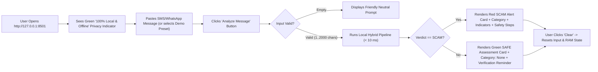

# 12 — UI/UX Specification

## 1. Design Objectives

The **Tinyverse Scam Detector** user interface (`app.py`, implemented in Milestone 4) is designed as a **clean, high-trust local cybersecurity dashboard**:
1. **Immediate Clarity Under Stress:** Users checking a scary SMS (*"Your bank account will be blocked tonight"*) are often anxious. The verdict (`SCAM` vs `SAFE`), category, and primary explanation must be readable in under 3 seconds.
2. **Honest Non-Alarmist Framing:** `SAFE` results must still remind users never to share OTPs or PINs; confidence percentages must be explained as model confidence scores rather than absolute guarantees.
3. **100% Local Self-Containment:** Zero external Google Fonts, zero remote icon packs, and zero CDN stylesheets—all styling uses standard system fonts (`Segoe UI`, `Inter`, `system-ui`, `monospace`) so the UI looks identical with Wi-Fi turned off.

---

## 2. User Personas

| Persona | Background | Primary Goal | Key UX Need |
|---|---|---|---|
| **Aarav (College Beginner / Hackathon Presenter)** | Computer science student demonstrating the detector offline to judges. | Quickly test English, Hinglish, obfuscated, and borderline messages live on stage. | Quick-load sample selector, clear technical metrics tab, visible `127.0.0.1` privacy badge. |
| **Meera (Everyday WhatsApp/UPI User)** | Receives frequent KYC, electricity bill, and part-time job offers on WhatsApp. | Know whether a link or payment request is fraudulent without uploading private chats. | Simple paste box, plain-language reasons, clear Red/Green visual distinction. |
| **Rajesh (Bank Customer Receiving Alerts)** | Receives both genuine bank debit/OTP messages and fake bank suspension links. | Avoid panicking over genuine bank alerts while catching real phishing messages. | Strong false-positive protection and clear distinction between an OTP alert and an OTP harvesting scam. |

---

## 3. User Journey Diagram



---

## 4. Dashboard Layout & Wireframes

### 4.1 Main Analyzer View (Text Wireframe)

```text
+-----------------------------------------------------------------------------------+
| [SHIELD] TINYVERSE SCAM DETECTOR                        [100% LOCAL | 127.0.0.1]  |
| On-Device Privacy-Preserving SMS & WhatsApp Fraud Analysis Engine                 |
+-----------------------------------------------------------------------------------+
| [Analyzer]  [How It Works & Architecture]  [Model & Evaluation]  [Privacy & Lim.] |
+-----------------------------------------------------------------------------------+
| Quick Demo Examples (Optional): [ Select a test message...                  v ]   |
|                                                                                   |
| Paste SMS or WhatsApp Message Below (Max 2,000 characters):                       |
| +-------------------------------------------------------------------------------+ |
| | Aapka KYC band ho jayega aaj raat 12 baje. Turant is link par click karke     | |
| | apna OTP aur PIN darj karein: bit.ly/kyc-abhi                                 | |
| +-------------------------------------------------------------------------------+ |
| [  ANALYZE MESSAGE (Primary Button)  ]   [  CLEAR (Secondary Button)  ]           |
+-----------------------------------------------------------------------------------+
| ANALYSIS RESULT                                                                   |
| +-------------------------------------------------------------------------------+ |
| | [!] VERDICT: SCAM                           CONFIDENCE SCORE: 94.6%           | |
| |     CATEGORY: KYC/Bank                      (Experimental Local Model Score)  | |
| +-------------------------------------------------------------------------------+ |
| | Why this message was classified as SCAM:                                      | |
| |  * Threatens account or KYC suspension with immediate urgency                 | |
| |  * Requests sensitive banking credentials (OTP / PIN)                         | |
| |  * Contains shortened URL ('bit.ly') combined with verification demand        | |
| |  * Matches statistical word & character n-gram patterns for KYC/Bank fraud    | |
| +-------------------------------------------------------------------------------+ |
| | SAFETY RECOMMENDATION:                                                        | |
| | Do NOT click the link or share any OTP, PIN, CVV, or password. Banks and      | |
| | government agencies never ask for your OTP or PIN via SMS/WhatsApp links.     | |
| +-------------------------------------------------------------------------------+ |
+-----------------------------------------------------------------------------------+
```

---

## 5. Visual Semantics & Color Palette

| State / Element | Background Color | Border / Accent Color | Text Color | Accessibility Contrast |
|---|---|---|---|---|
| **SCAM Verdict Banner** | `#FEF2F2` (Soft Red) | `#DC2626` (Crimson Red) | `#991B1B` (Dark Red) | WCAG AAA (`> 7:1`) |
| **SAFE Verdict Banner** | `#F0FDF4` (Soft Green) | `#16A34A` (Forest Green) | `#166534` (Dark Green) | WCAG AAA (`> 7:1`) |
| **Neutral / Info Card** | `#F8FAFC` (Slate 50) | `#CBD5E1` (Slate 300) | `#1E293B` (Slate 800) | WCAG AAA (`> 8:1`) |
| **Warning / Validation Notice** | `#FFFBEB` (Amber 50) | `#D97706` (Amber 600) | `#92400E` (Amber 800) | WCAG AA+ |

---

## 6. Required Informational Tabs / Sections

1. **About & Problem Statement:** Explains Indian SMS/WhatsApp fraud vectors and why cloud message scanning threatens financial privacy.
2. **How It Works:** Visualizes the normalization, Word+Char TF-IDF, local Logistic Regression, and explainable Rule Engine pipeline.
3. **Privacy & Offline Guarantee:** Displays the active loopback binding (`127.0.0.1`), zero-retention policy, and live status from `src/privacy_audit.py`.
4. **Model & Dataset Information:** Shows live metadata from `models/scam_detector.joblib` (model version, feature count, dataset size, class/language breakdown).
5. **Measured Evaluation Results:** Displays real held-out test metrics (`Accuracy`, `Precision`, `Recall`, `F1`, `SAFE False-Positive Rate`, `Category Macro-F1`, and the `reports/confusion_matrix.png` chart).
6. **Known Limitations:** Explicitly discloses the synthetic nature of the starter dataset, probability calibration limits, and the need for independent user verification.
